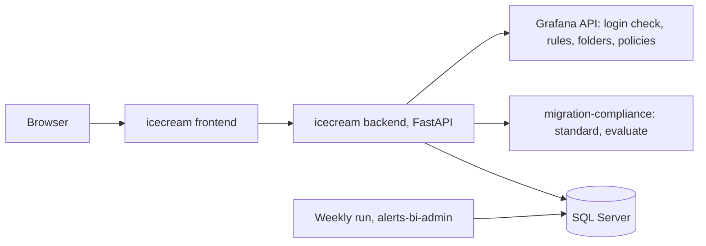

# Handoff: icecream, one portal for the weekly alert review and rule migration

**Written:** 2026-11-24 · **For:** whoever designs and builds icecream · **Branch:**
`icecream/mock-handoff` in `alerts-bi-design`

**Status:** proposal. The mock and the decisions below were reviewed with the product owner.
They are not yet in [`alerts_bi_design.md`](../alerts_bi_design.md); once accepted, record
them there with a date, as `AGENTS.md` requires. The next step is a spec in the team template
(Intro, Requirements, Proposed Implementation, Summary) built from this handoff.

Files on this branch:

| Path | What it is |
|---|---|
| `docs/handoffs/2026-11-24-icecream-portal.md` | This file: what we want to build, decisions, the work list |
| `docs/mockups/icecream/index.html` + `app.js` | The clickable mock |
| `docs/mockups/icecream/README.md` | How to open the mock and what each screen shows |
| `docs/mockups/icecream/DESIGN.md` | The visual design: colours, type, the "strip", layout rules |
| `docs/mockups/icecream/PRODUCT.md` | Users, purpose, principles |

---

## 1. What we want to build

Today a team uses two tools with two logins:

- **alerts-bi portal**: the weekly review of the team's alerts (what fired, what is wrong, how
  far the team is from the v2 standard).
- **alerts-migration** (migration-frontend + migration-ui-backend): turns a v1 Grafana alert rule
  into a v2 rule that meets the alert standard.

**icecream** replaces both with one site, one login and one model: *a team owns Grafana rules,
and rules fire alerts.* The weekly review shows the alerts; migration acts on the rules; the
"migrated" state is live everywhere. A team member opens their team, sees what to fix, and fixes
it rule by rule without changing tools.

Goals:

1. One frontend and one backend, replacing alerts-bi-portal and the alerts-migration UI and
   backend.
2. Teams are stored in the database and edited in the UI, not in the hand-edited JSON registry
   (ConfigMap `alerts-bi-registry`).
3. "Migrated" comes live from the migration registry, not from the weekly run, and it works
   (it does not today; see section 5).
4. When several selected alerts come from one Grafana rule, the UI says so, and migration
   changes that rule once.
5. Migrate, New v2 rule and Edit v2 rule are always one click away inside a team.

## 2. Open the mock

```bash
python -m http.server 8240 --directory docs/mockups/icecream
```

Open `http://localhost:8240/`. Opening `index.html` directly from disk also works. All data is
invented. **Checkout Platform** is the complete sample team; open it first. The yellow bar at the
top belongs only to the mock: it jumps straight to each screen, and **Reset** restores the
sample data. Sign in with any username and password.

## 3. What the mock shows

**Sign in:** username and password, the same LDAP credentials as Grafana.

**Teams:** every team, in alphabetical order. **New team** and an **Edit** button on each team.
The team window has:

- **Name:** suggests LDAP group names that have no team yet.
- **v1 operators** (optional): free text, as chips.
- **v2 operators** (optional): multi-select of `Appchi - …` notification policies; each policy
  shows which teams already use it.
- **Folders** (optional): Grafana folder URLs. The URL itself is stored and shown.

**Team page:** the team name with three actions on the right, then six tabs. The actions are
**Migrate rules** (primary), **New v2 rule** and **Edit v2 rule**. They stay in the same place
on every team page, including the rule and alert pages. Each opens its own page, and **Back**
returns to where you came from. Week and application filters appear on the weekly tabs
(Overview, Action plan, Alerts, Volume).

| Tab | Shows |
|---|---|
| Overview | "N of M rules are on v2" as a rack of rule marks grouped by state (each opens the rule; each group opens Rules filtered to it); this week next to the week before; problems this week; side column with phase, operators and the loudest alert. No folders table. |
| Action plan | "Start here": up to 5 rules, at most 2 per state. Then four columns: Delete, Fix the noise, Review, Ready to migrate. Each rule has its action. A summary of Appchi V2 alerts. |
| Alerts | The week's alerts, To fix / All, v1 / v2, search. Checkboxes for migration, with same-rule marking (section 4.1). |
| Rules | Live: one section per team folder URL plus "Other rules that fired this week". Filter by state. Each rule shows its state (migrated by whom and when; copy of; new), alerts this week and its action. "Migrate N v1 rules" per folder. |
| Volume | Alerts by events, active time, pattern. |
| History | The phase line, then one row per published week with bars: Appchi alerts, v1 rules that fired, V2 alerts, meeting the standard, rules migrated. |

**Rule page** (click any rule): this week's alerts from the rule, what to fix, the migration
record (by, when, link to the v2 copy), labels and annotations, and **Migrate** or **Edit v2 rule**.

**Alert page:** the alert's fields shown against the standard, as read-only field cards with the
same badges as the migration form. It also links the other alerts from the same rule.

**Migrate rules:** a checklist of the team's v1 rules (from its folders) and **Load by URL**
(a rule or folder URL, as in today's tool) with the notification policy. The form, one rule at a
time when several are queued, has:

- the alerts that brought you here, and the other alerts from the same rule;
- **Create the v2 rule in**: the same folder, one of the team's folders, or another folder URL;
- the notification policy;
- the field cards (section 4.4);
- **Create v2 rule**, or **Create v2 rule and delete the original**; **Skip this rule** when
  several rules are queued.

**New v2 rule:** folder (team folders or another URL), title and policy, then the same field cards.

**Edit v2 rule:** the team's v2 rules, or **Open by URL**, then the field cards with **Save
changes** and **Delete rule** (with a confirmation). Deleting a migrated copy makes its original
"not migrated" again (section 4.2).

## 4. Behaviour to keep

### 4.1 Alerts from the same rule

- Several alerts can come from one rule (fan-out by `$labels`). When a rule has more than one
  alert this week, its alerts carry the same letter (A, B, C).
- When an alert is selected, its row gets a solid marker. Unselected alerts from the same rule
  get a dashed marker and the note "Changes too: same rule as a selected alert". Selected
  siblings say "Same rule as N other selected alert".
- The selection bar reads "3 alerts selected, from 2 rules". It groups the selection by rule and
  lists "Also from this rule: … **Select**".
- Siblings are **marked, not auto-selected** (decided).
- Migration runs once per rule, not once per alert.

### 4.2 Migrated status

- It comes live from the migration registry (the table `migrations`: `original_uid`,
  `created_uid`, `folder_uid`, `created_via`, `migrated_by`, `migrated_at`, `deleted_original`),
  never from the weekly run.
- **Copy-exists rule:** an original counts as migrated only while its v2 copy still exists in
  Grafana. Deleting the copy makes the original "not migrated" again. This matches
  migration-ui-backend today.
- Weekly numbers (alerts, events, problems, phase) stay weekly.

### 4.3 Rule states

Each v1 alert gets the first state that matches, in this order. A rule takes the most urgent
state among its alerts this week. A rule that fired nothing is "Ready to migrate".

| State | When | Action |
|---|---|---|
| Delete | Heartbeat, or Hidden in panel | Delete in Grafana |
| Fix the noise | Pattern Stuck or Flapping | Fix in Grafana |
| Review | Generic message, No rule URL, or Critical without a runbook | Review and migrate |
| Ready to migrate | Anything else | Migrate |

There are two more states: **Migrated** (from the registry) and **V2** (already a v2 rule).
Alerts with no Grafana rule (API senders) show "Change at the sender".

### 4.4 Field cards

The form is the migration tool's, driven by `migration-compliance/src/standard/schema.json`
(12 fields). `Send-Alert` and `Appchi-$operator` are hidden; the operator comes from the chosen
notification policy. The order is the same as migration-frontend's `sortFieldsForDisplay`: site,
then required fields, then fields with defaults, then the rest. The badges are the same as
`FieldRenderer`: Carried over, Default applied, Needs input (with the reason), Required.
**Create** lists any missing required fields.

## 5. Why "Migrated" does not show today

The chain:

1. The portal (`alerts-bi-portal/src/migration.py`) takes rule UIDs from the alerts' rule URLs
   (`/alerting/grafana/<uid>/view|edit`).
2. It calls `POST <base>/api/rules/migration-status` with a bearer token. The base is
   `PORTAL_MIGRATION_API_URL`, or `PORTAL_MIGRATION_URL` when that is unset. The token is
   `PORTAL_MIGRATION_STATUS_TOKEN`. The timeout is `PORTAL_MIGRATION_STATUS_TIMEOUT`, **1 s by
   default** (10 s maximum).
3. The backend (`migration-ui-backend/app/routes/status.py`) reads the latest registry row per
   UID (100 UIDs per call). It then lists **all** Grafana rules to check that each copy still
   exists.
4. Any failure logs `portal.migration_status_unavailable`, and the page shows plain "Migrate".

Likely causes, most likely first:

1. **Timeout:** listing every Grafana rule takes longer than 1 s.
2. **Token:** `PORTAL_MIGRATION_STATUS_TOKEN` is unset (the portal skips the call), or the
   backend's `MIGRATION_STATUS_TOKEN` is unset (404) or different (401).
3. **Wrong address:** without `PORTAL_MIGRATION_API_URL`, the call goes to the frontend. Its
   nginx proxies to `BACKEND_URL`, which defaults to `http://migration-backend:8000`, but the
   FastAPI backend listens on port 3000.
4. **Old backend:** if production still runs the Express backend (`src/`), the endpoint does
   not exist.
5. **No registry rows:** rules migrated before the registry existed, migrated by hand, or in
   another environment. The seed only runs from the folder view.

To check: search the portal logs for `portal.migration_status_unavailable` and read its reason.
Call the endpoint with `curl` and the token from inside the portal pod. Count the rows in
`migrations.db`.

The fix belongs in the new backend: answer migration status from the registry (indexed by
original UID) plus a cached Grafana rule list, not by listing all rules on every request. Until
icecream ships, a quick fix in the portal and the backend (timeout, token, URL) is worth doing
on its own.

## 6. Target architecture



| Area | Decided | Proposed (confirm in the spec) |
|---|---|---|
| Frontend | One site replaces both UIs | React, starting from migration-frontend (it already has the login, field cards and folder view) |
| Backend | One backend replaces the portal's read path and migration-ui-backend | FastAPI, starting from migration-ui-backend's `app/` |
| Teams | Stored in the database, edited in the UI; everyone sees and edits every team for now | A `teams` table plus child tables for v1 operators, v2 operators (now several per team) and folder URLs |
| Migration registry and sessions | Live, from the migration tool's own records | Move from SQLite (`migrations.db`, `sessions.db`) to SQL Server |
| Weekly review | Stays weekly | The weekly run reads teams from the database instead of the JSON registry |
| Sign-in | LDAP, the same credentials as Grafana | Keep migration-ui-backend's flow: check the credentials with Grafana `GET /api/user`, then server sessions (7 days idle, 30 days max, re-checked every 24 h) |
| Old URLs | Redirect to icecream | Run both for about 2 weeks, then retire alerts-bi-portal and the alerts-migration UI |

## 7. Work list

Rough order. Phase A can ship on its own, today.

**A. Fix "Migrated" in the current tools**
1. Find the cause (section 5) and fix the configuration: token, `PORTAL_MIGRATION_API_URL`,
   `BACKEND_URL`, timeout.
2. If the timeout is the cause: cache the Grafana rule list in migration-ui-backend.

**B. Spec and decisions**
3. Write the spec from this handoff, one recommendation per area.
4. Record the accepted decisions in `alerts_bi_design.md`, and update `teams.schema.json` or
   replace it with the database contract.

**C. Data (SQL Server)**
5. Teams tables: name, v1 operators, v2 operators (list), folder URLs, plus what the registry has
   today (`panels`, `weekly_review.enabled`, `planning.v1_rule_effort_days`).
6. Import the current JSON registry once.
7. Move the migration registry and sessions from SQLite. Import the existing `migrations.db`
   rows.
8. The weekly run reads teams from the database and supports several v2 operators.

**D. Backend**
9. Sign-in and sessions (from migration-ui-backend).
10. Teams API: list, create, edit, LDAP group names for suggestions.
11. Weekly read path (the portal's `portal_*` views): overview, action plan, alerts, volume,
    history.
12. Rules API: rules in the team's folders, each with its live state (registry plus a cached
    Grafana list).
13. Migrate, create, edit and delete a v2 rule (from migration-ui-backend), with the folder
    permission check and the compliance calls.

**E. Frontend**
14. The screens in section 3, following `DESIGN.md`.
15. Same-rule marking, the selection bar and the migration queue.

**F. Cutover**
16. Redirects from the old portal and migration URLs (deep links to a team or rule land on the
    same thing).
17. Run both for about 2 weeks, then retire the old services.

## 8. Open questions

- **Permissions later:** for now everyone sees and edits every team. Will this later be filtered
  by LDAP group or Grafana team?
- **Dashboard panels:** the registry's `panels` drive "Hidden in panel". The mock's team window
  does not edit them. Should they be added to the window, or kept elsewhere?
- **Delete the original:** with "Create v2 rule and delete the original", the copy-exists rule
  still marks the original migrated while the copy exists. Confirm that this is the wanted reading.
- **Rules that fired nothing** count as "Ready to migrate" in the mock. Is that right?
- **Overview comparisons:** "the week before" uses the previous published week. Should "Rules
  migrated" per week use `migrated_at` from the registry (as in the mock)?
- **Edit and delete rights** on v2 rules: are they the same folder permission check as migration?
- **Redirect period:** about 2 weeks was suggested, not confirmed.
